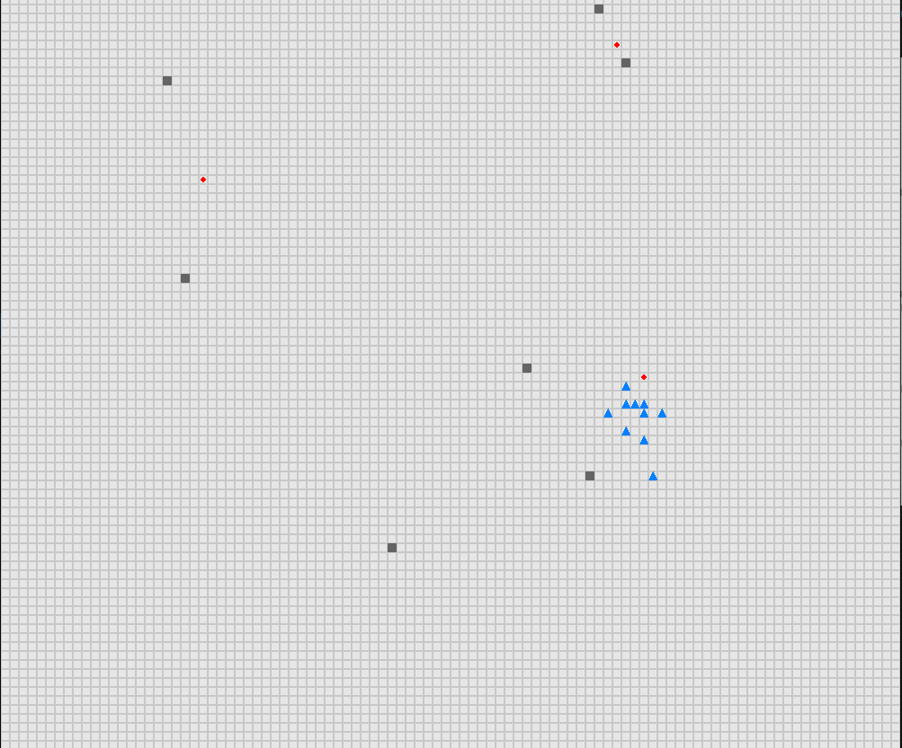
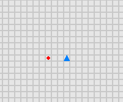
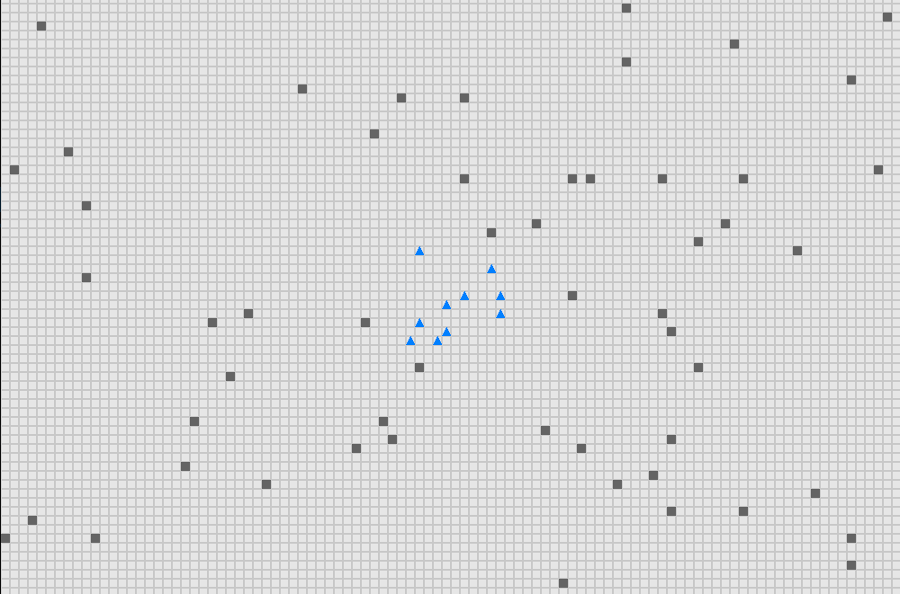

<div align="center">

# 🛩️ Distributed UAV Swarm Formation Control
### via Object-Focused, Multi-Objective SARSA

**Teach a swarm of UAVs to flock, chase waypoints and dodge obstacles — using only local information and tabular reinforcement learning.**




</div>

An implementation of **OF-GM-SARSA** from *Speck & Bucci, "Distributed UAV Swarm Formation Control via Object-Focused, Multi-Objective SARSA"* ([ACC 2018](https://doi.org/10.23919/ACC.2018.8430773), [arXiv:1809.00096](https://arxiv.org/abs/1809.00096)).

## Table of contents
- [Why this approach?](#why-this-approach)
- [How it works](#how-it-works)
- [Quick start](#quick-start)
- [Training in three phases](#training-in-three-phases)
- [Configuration](#configuration)
- [Project structure](#project-structure)
- [Citation](#citation)
- [License](#license)

## Why this approach?

Swarm control usually forces a trade-off between hand-tuned rules (brittle) and end-to-end deep RL (data-hungry, opaque). OF-GM-SARSA sits in the middle:

| Idea | What it buys you |
|---|---|
| **Decentralized** | Every UAV runs the same small policy from local observations — no central controller. |
| **Object-focused** | One small Q-table is reused for *each* nearby neighbor or obstacle, so the state space stays tiny no matter how big the swarm gets. |
| **Multi-objective / modular** | Each behavior (module) learns its own Q-table; modules can be trained separately and recombined. |
| **Greatest-mass action selection** | Modules vote on a heading with a weighted sum of Q-values, so behavior is tunable by changing weights, not retraining. |

## How it works

```
 For each UAV, at every step:

   nearby neighbors / obstacles / waypoint
              │
              ▼
   ┌───────────────────────────────────────────┐
   │  Behavior modules, each with its own      │
   │  Q-table, applied per observed object:    │
   │   TGT  target seeking                     │
   │   COH  cohesion       ┐                   │
   │   COL  collision avoid├─ Reynolds flocking│
   │   ALN  alignment      ┘                   │
   │   OBS  obstacle avoidance                 │
   └───────────────────────────────────────────┘
              │  weighted Q-values (w per module)
              ▼
   Greatest mass: pick the heading with the
   highest weighted sum  ──►  move
```

The module weights (`w`) and discount factors live in the YAML configs, so you can reshape swarm behavior without touching code.

## Quick start

> Tested with **Python 3.10** (`requirements.txt` pins `numpy==1.23.5`, which needs Python ≤ 3.11).

```bash
git clone https://github.com/ahmedmsalah99/Distributed-UAV-Swarm-Formation-Control-via-Object-Focused-Multi-Objective-SARSA.git
cd Distributed-UAV-Swarm-Formation-Control-via-Object-Focused-Multi-Objective-SARSA
python -m venv .venv && source .venv/bin/activate
pip install -r requirements.txt
```

**Watch the pretrained swarm** (phase 3 config ships with `mode: test` and trained Q-tables from `results/`):

```bash
python train.py configs/train_phase3.yaml
```

**Train from scratch** — open a config, set `mode` to `train`, then run it:

```yaml
mode:
  - train      # use `- test` to evaluate saved Q-tables
```

```bash
python train.py configs/train_phase1.yaml
```

Despite the name, `train.py` handles both training and testing; the `mode` field in the YAML decides which.

## Training in three phases

Behaviors are learned progressively, then combined.

| Phase | Config | What is learned | Scenario |
|---|---|---|---|
| **1 · Target seeking** | `configs/train_phase1.yaml` | `TGT` | A single UAV flies to a random waypoint, no obstacles. |
| **2 · Flocking & obstacle avoidance** | `configs/train_phase2.yaml` | `COH`, `COL`, `ALN`, `OBS` | A fixed-size swarm with randomized obstacle positions. |
| **3 · Full integration** | `configs/train_phase3.yaml` | All five modules together | A random fixed-size swarm heads to waypoints while avoiding a random number of obstacles. |

<table>
<tr>
<td align="center"><b>Phase 1</b><br></td>
<td align="center"><b>Phase 2</b><br></td>
</tr>
</table>

## Configuration

Each YAML file has four sections:

| Section | Purpose | Examples |
|---|---|---|
| `mode` | `train` or `test` | `- test` |
| `training_params` | SARSA settings | `alpha`, `T` (softmax temperature), `number_episodes`, `save_folder` |
| `env` | Simulation world | `agents_num`, `obstacles_num`, `waypoints_num`, `x_size`, `y_size`, `timeout`, `agent_speed` |
| `active_modules` | Which behaviors run | per module: `w` (weight), `discount`, distance thresholds, `Qmatrix_path` |

Trained Q-tables (`Qmatrix_*.npy`), configs and learning curves are stored in [`results/`](results/).

## Project structure

```
├── train.py                # Entry point for training and testing
├── configs/                # Per-phase YAML configurations
├── results/                # Pretrained Q-tables + training curves (phase1-3)
├── resources/              # Images and GIFs used in this README
├── uav_env/                # PettingZoo-style multi-UAV environment
├── modules/                # Behavior modules (TGT, COH, COL, ALN, OBS)
├── common/                 # SARSA learner, config parser, utilities
└── test.py                 # PettingZoo API conformance test for the environment
```

## Citation

If this repo helps your work, please cite the original paper:

```bibtex
@inproceedings{speck2018distributed,
  title     = {Distributed UAV Swarm Formation Control via Object-Focused, Multi-Objective {SARSA}},
  author    = {Speck, Christian and Bucci, Donald J.},
  booktitle = {2018 Annual American Control Conference (ACC)},
  year      = {2018},
  doi       = {10.23919/ACC.2018.8430773}
}
```

## License

Released under the MIT License.

## Contributing

Issues and pull requests are welcome — if you spot a bug or have an idea for a new behavior module, open an issue.
